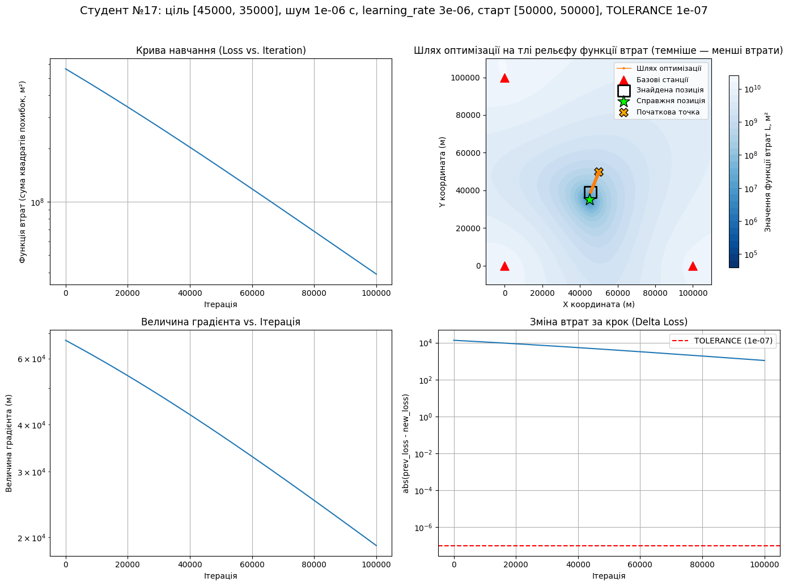
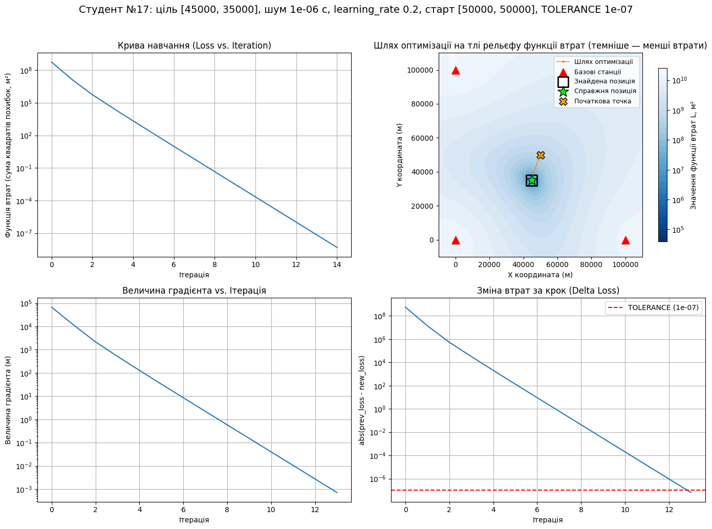
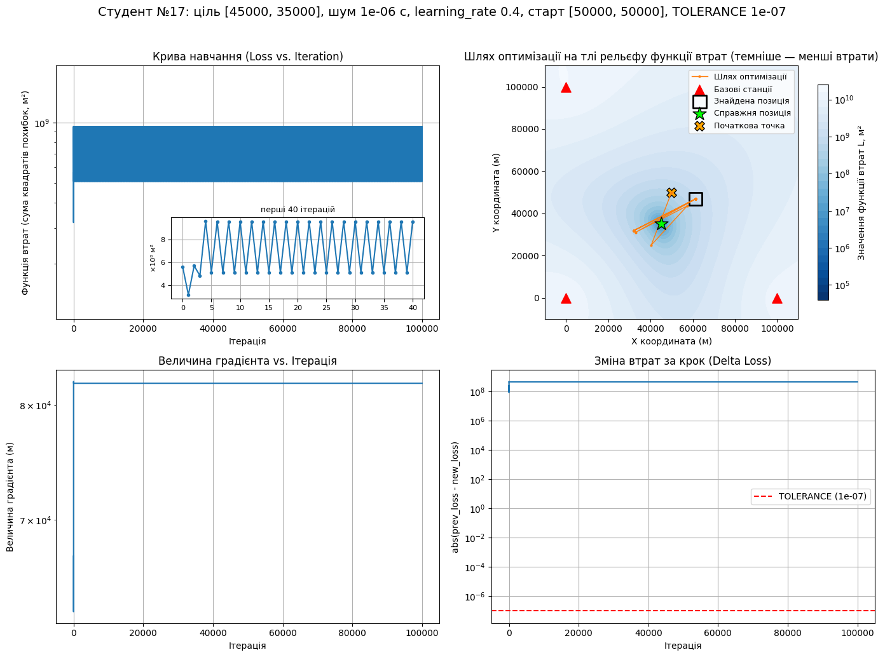
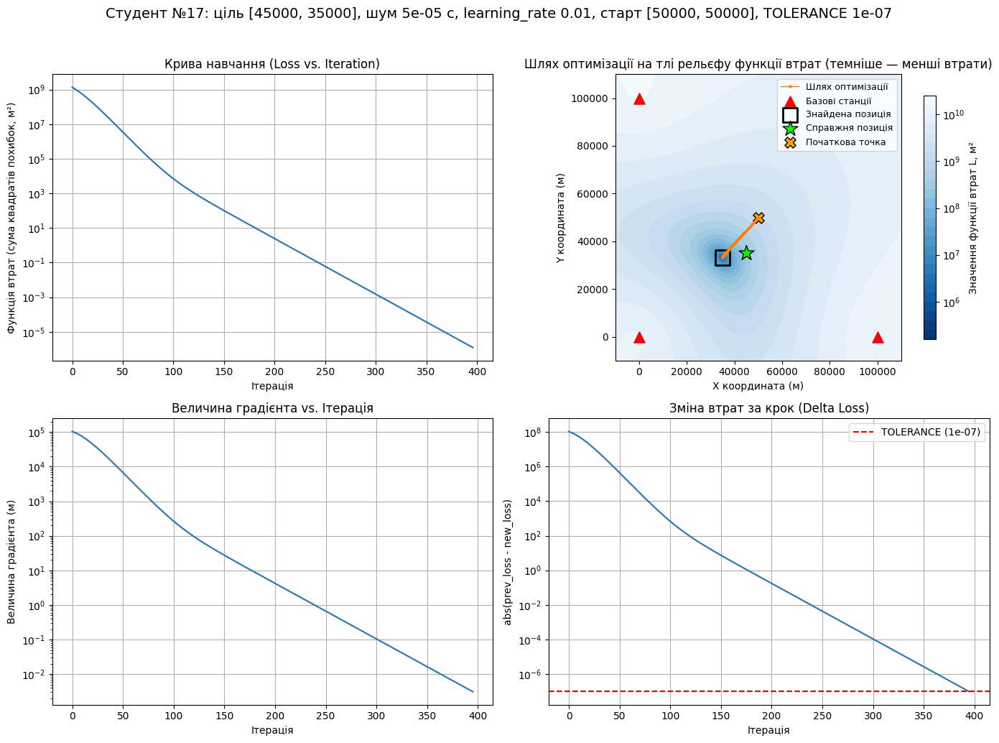
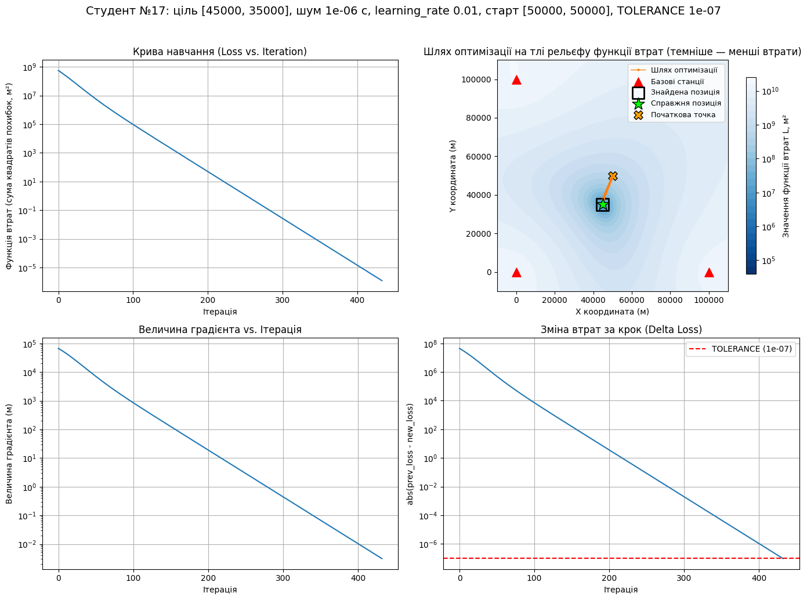
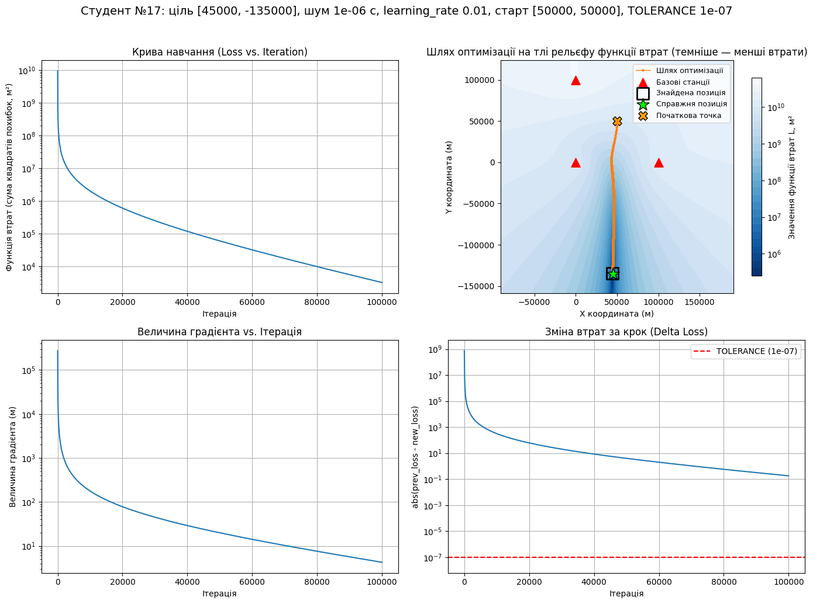
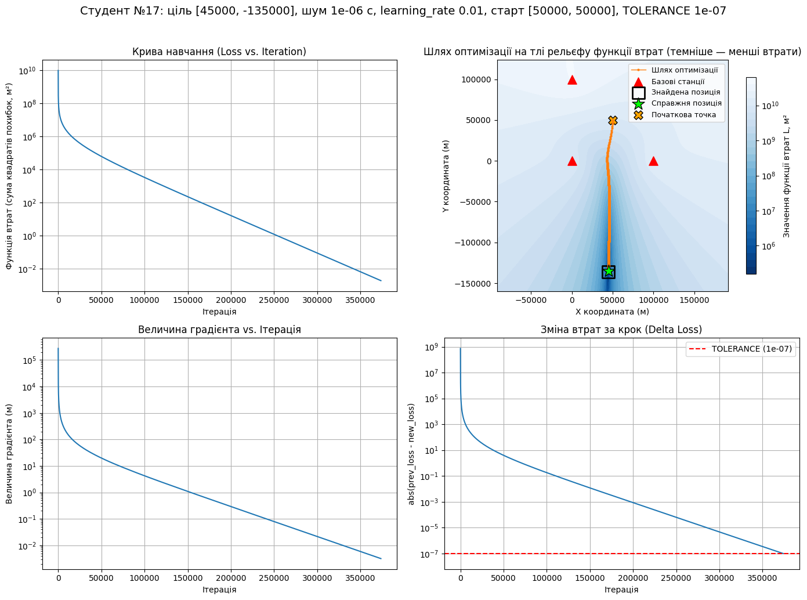

# Дослідження методу градієнтного спуску для розв’язання задачі мультилатерації (TDoA)

**Студент №17** (`STUDENT_NUMBER = 17`)

## Експеримент 1. Контрольний запуск

```python
run()
```

```
Справжня позиція: (45000.00, 35000.00) м
Знайдена позиція: (45000.00, 35000.00) м
Похибка позиціонування: 0.000830 м (0.83 мм)
Ітерацій: 433 (зупинка: зміна втрат за крок < TOLERANCE = 1e-07)
Фінальне значення функції втрат: 1.27e-06 м²
```


*Рис. 1 — Експеримент 1: контрольний запуск без шуму*

**Що видно.** Без шуму алгоритм знаходить ціль із похибкою 0,83 мм. Це число не нуль, бо спуск зупиняється, щойно зміна втрат за крок стає меншою за `TOLERANCE`. Втрати зменшуються від 5,5·10⁸ до 1,3·10⁻⁶ м² за 433 ітерації, а крива навчання, градієнт і зміна втрат спадають рівними прямими на логарифмічній шкалі. Шлях — майже пряма від старту до цілі по схилу єдиної улоговини рельєфу.

## Експеримент 2. Швидкість навчання

```python
run(noise_level=1e-6, learning_rate=3e-6)   # 2a
run(noise_level=1e-6, learning_rate=0.01)   # 2b
run(noise_level=1e-6, learning_rate=0.2)    # 2c
run(noise_level=1e-6, learning_rate=0.4)    # 2d
```

| Запуск | learning_rate | Ітерацій | Причина зупинки | Похибка, м | Фінальне значення втрат, м² |
| --- | --- | --- | --- | --- | --- |
| 2a | 3e-6 | 100 000 | вичерпано MAX_ITERATIONS | 4106,04 | 3,91e+07 |
| 2b | 0.01 | 433 | TOLERANCE | 204,17 | 1,22e-06 |
| 2c | 0.2 | 14 | TOLERANCE | 204,17 | 4,80e-09 |
| 2d | 0.4 | 100 000 | вичерпано MAX_ITERATIONS | 20 183,34 | 9,53e+08 |



*Рис. 2 — Експеримент 2a: замалий крок (стагнація)*

**Що видно (2a).** Точка рухається в правильному напрямку, але за 100 000 ітерацій проходить лише близько трьох чвертей шляху (з відстані 15,8 км до цілі лишається 4,1 км). Втрати впали лише з 5,6·10⁸ до 3,9·10⁷ м², тобто на один порядок (у 2b на чотирнадцять порядків за 433 ітерації). Зміна втрат за крок (≈10³ м²) залишилась на десять порядків вище за `TOLERANCE`.



*Рис. 3 — Експеримент 2c: крок 0.2 — та сама точка, що й у 2b, за 14 ітерацій*

**Що видно (2c).** Результат той самий, що й у 2b (похибка 204,17 м), але за 14 ітерацій замість 433, тобто приблизно в 31 раз швидше. Шлях складається з кількох довгих кроків.



*Рис. 4 — Експеримент 2d: завеликий крок (осциляція)*

**Що видно (2d).** Точка перестрибує через мінімум туди-сюди між двома положеннями приблизно за 33 км одне від одного ((32 171; 31 809) і (61 359; 46 821) м). Після перших кількох кроків втрати чергуються між двома значеннями (≈5,1·10⁸ і ≈9,5·10⁸ м²) і до кінця не зменшуються. Наприкінці вони навіть більші, ніж на старті (9,53·10⁸ проти 5,63·10⁸ м²). Градієнт (≈8·10⁴) і зміна втрат за крок (≈4·10⁸) є сталими лініями, на ≈15 порядків вище за `TOLERANCE`. Похибка — 20,2 км. Сто тисяч стрибків на кривій навчання зливаються в суцільну смугу, тому в рамці показано перші 40 ітерацій.

## Експеримент 3. Рівень шуму

```python
run(noise_level=1e-9)   # 3a
run(noise_level=1e-6)   # 3b (= 2b)
run(noise_level=5e-5)   # 3c
```

| NOISE_LEVEL, с | Шум у метрах, c·NOISE_LEVEL | Ітерацій | Похибка, м | Фінальне значення втрат, м² |
| --- | --- | --- | --- | --- |
| 1e-9 | 0,30 | 433 | 0,204457 (204,46 мм) | 1,27e-06 |
| 1e-6 | 300 | 433 | 204,17 | 1,22e-06 |
| 5e-5 | 15 000 | 396 | 10 125,84 | 1,25e-06 |



*Рис. 5 — Експеримент 3c: зламана синхронізація, шум 50 мкс*

**Що видно.** Усі три запуски зупиняються за умовою `TOLERANCE` (за 396–433 ітерації) з майже нульовими втратами (≈10⁻⁶ м²), тобто для алгоритму всі три задачі розв'язані «ідеально». Похибка при цьому зростає разом із шумом майже в стільки ж разів: шум ×1000 (3a → 3b) дає похибку ×999, шум ×50 (3b → 3c) — ×49,6. У 3c мінімум рельєфу (темна пляма) лежить приблизно за 10,1 км від справжньої позиції, і алгоритм приходить точно в нього: знайдена позиція (35 030,5; 33 227,5) м збігається з мінімумом функції втрат для цих вимірювань.

## Експеримент 4. Початкове наближення

```python
run(noise_level=1e-6, initial_guess=[50000, 50000])       # 4a (= 2b)
run(noise_level=1e-6, initial_guess=[0, 0])               # 4b
run(noise_level=1e-6, initial_guess=[-500000, -500000])   # 4c
```

| Запуск | Старт, м | Ітерацій | Причина зупинки | Похибка, м | Фінальне значення втрат, м² |
| --- | --- | --- | --- | --- | --- |
| 4a | (50 000, 50 000) | 433 | TOLERANCE | 204,17 | 1,22e-06 |
| 4b | (0, 0) | 398 | TOLERANCE | 204,17 | 1,22e-06 |
| 4c | (−500 000, −500 000) | 100 000 | вичерпано MAX_ITERATIONS | 1 005 416,92 | 6,03e+09 |


*Рис. 6 — Експеримент 4c: старт далеко за межами станцій*

**Що видно.** 4a і 4b приходять в одну й ту саму точку (похибка 204,17 м). Старт 4b у 3,6 раза далі від цілі й має втрати 1,4·10¹⁰ проти 5,6·10⁸, але алгоритм дістається туди навіть трохи швидше (398 ітерацій проти 433). У 4c шлях іде не до станцій, а геть від них (від старту 707 км від центру станцій до 964 км) і за 100 000 ітерацій закінчується приблизно за мільйон метрів від цілі. Далеко від станцій функція втрат майже пласка: крива навчання виходить на полицю близько 6·10⁹ м² (початкове значення 7,0·10⁹), на ≈15 порядків вище, ніж у 4a, а градієнт і зміна втрат за крок застигають на сталих значеннях, далеких від `TOLERANCE`.

## Експеримент 5. Геометрія станцій (GDOP)

```python
run(noise_level=1e-6, true_position=[45000, 35000])     # 5a (= 2b)
run(noise_level=1e-6, true_position=[45000, -135000])   # 5b
run(noise_level=1e-6, true_position=[45000, -135000], max_iterations=1000000)   # 5c
```

| Запуск | Ціль, м | Ітерацій | Причина зупинки | Похибка, м | Фінальне значення втрат, м² |
| --- | --- | --- | --- | --- | --- |
| 5a | (45 000, 35 000) | 433 | TOLERANCE | 204,17 | 1,22e-06 |
| 5b | (45 000, −135 000) | 100 000 | вичерпано MAX_ITERATIONS | 664,79 | 3,27e+03 |
| 5c | (45 000, −135 000) | 373 719 | TOLERANCE | 1213,08 | 1,92e-03 |



*Рис. 7 — Експеримент 5a: ціль між станціями*



*Рис. 8 — Експеримент 5b: ціль далеко збоку від станцій*



*Рис. 9 — Експеримент 5c: та сама геометрія, 1 000 000 дозволених ітерацій*

**Що видно.** На рельєфі 5a мінімум — компактна улоговина між станціями, у 5b — довгий вузький «каньйон», витягнутий від станцій до цілі. Шлях 5b швидко скочується на дно каньйону, а далі повзе вздовж нього: за 100 000 ітерацій зміна втрат за крок (≈0,18) так і не опускається до `TOLERANCE`. У 5c алгоритм зупиняється за умовою `TOLERANCE` на 373 719-й ітерації. Шум той самий, що в 5a, але похибка — 1213 м проти 204 м, майже в 6 разів більша. У моєму варіанті 5c гірший за 5b (1213 м проти 665 м): 5b зупинився раніше, ще не дійшовши до мінімуму зашумленого рельєфу, а цей мінімум лежить далі від справжньої позиції. Тому більша кількість ітерацій не гарантує меншої похибки.

## Експеримент 6 (бонус). Умова зупинки

```python
run(tolerance=1e-2)                      # 6a
run(tolerance=1e-7)                      # 6b (= контрольний запуск)
run(tolerance=1e-12)                     # 6c
run(noise_level=1e-6, tolerance=1e-2)    # 6d
run(noise_level=1e-6, tolerance=1e-12)   # 6e
```

| Запуск | TOLERANCE | Шум, с | Ітерацій | Похибка, м | Фінальне значення втрат, м² |
| --- | --- | --- | --- | --- | --- |
| 6a | 1e-2 | 0 | 280 | 0,260860 | 0,125 |
| 6b | 1e-7 | 0 | 433 | 0,000830 | 1,27e-06 |
| 6c | 1e-12 | 0 | 587 | 0,000003 (2,55 мкм) | 1,2e-11 |
| 6d | 1e-2 | 1e-6 | 280 | 204,24 | 0,121 |
| 6e | 1e-12 | 1e-6 | 586 | 204,17 | 1,23e-11 |

**Що видно.** Без шуму кожне посилення умови зупинки в 10⁵ разів зменшує похибку приблизно на два з половиною порядки (26 см → 0,8 мм → 2,6 мкм) ціною лише ~150 додаткових ітерацій. З шумом 1 мкс ті самі 306 додаткових ітерацій змінюють похибку з 204,24 до 204,17 м, тобто на ≈7 см із 204 м (менше за 0,04 %).

## Загальні висновки

- **Крок навчання** має «робочий діапазон»: замалий (3e-6) призводить до стагнації, у 2a не дійшли до цілі за 100 000 ітерацій; завеликий (0.4) — до осциляції без збіжності. Крок 0.2 дає ту саму точку, що й 0.01, у 31 раз швидше.
- **Шум вимірювань** задає межу точності: алгоритм завжди сходиться до мінімуму зашумленого рельєфу (втрати ≈10⁻⁶ м²), і похибка пропорційна шуму (0,2 м → 204 м → 10,1 км). Малі втрати не означають, що знайдена позиція близька до справжньої.
- **Початкове наближення** впливає, лише коли старт дуже далеко від станцій: там функція втрат пласка, і спуск іде геть від цілі (4c).
- **Геометрія станцій** (GDOP): якщо ціль далеко збоку від станцій, мінімум стає вузьким каньйоном, спуск повзе повільно, а той самий шум дає похибку, більшу майже втричі (5b) або майже вшестеро (5c) порівняно з ціллю між станціями (5a).
- **Умова зупинки** з шумом майже нічого не дає: коли похибка визначається шумом, суворіший `TOLERANCE` лише витрачає ітерації.
